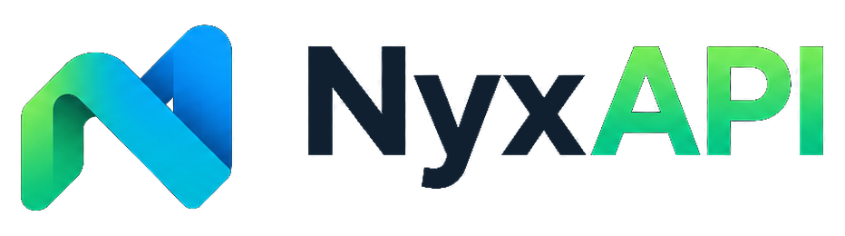

# NyxAPI

<p align="center">
  <picture>
    <source media="(prefers-color-scheme: dark)" srcset="assets/logo-dark.png" />
    
  </picture>
</p>

Schema-generated, fluent, fully typed API client with a standalone query/mutation engine (no React required) and a React adapter.

> **Status: 0.1.x, pre-1.0.** The API can change between minor versions; the website has a release history. See [ROADMAP.md](ROADMAP.md) (also on the website as the Roadmap page, with known limitations and open tasks) for what is and isn't done, and [docs/ARCHITECTURE.md](docs/ARCHITECTURE.md) / [docs/API-DESIGN.md](docs/API-DESIGN.md) for the design and public contracts. Guides for schema-less (manual) endpoints, HTTP, techniques, best practices and integrations, plus a 30-episode tutorial playlist plan ([docs/TUTORIALS.md](docs/TUTORIALS.md)), are on the website.

```ts
const user = await api.users.byId("42").get();
const session = await api.auth.login.post({ email: "dev@example.com", password: "secret" });
const page = await api.users.list.get({ query: { page: 1, limit: 20 } });

// React
const user = useQuery(api.users.byId(userId).get.options());
const update = useMutation(api.users.byId(userId).patch.options());
update.mutate({ name: "New name" });
```

## Documentation

The website has the full docs (every option of the client, queries, mutations, pagination and errors can be run in the page), a playground, the release history and the roadmap. Run it locally with `pnpm website:dev`, or see [website/README.md](website/README.md).

## Try it

```bash
pnpm install
pnpm check                 # lint + typecheck + tests + build + generated-code drift check
pnpm generate:example      # fixtures/openapi/basic.yaml → examples/basic/generated/
pnpm bench                 # headless benchmarks (see benchmarks/README.md)
```

Generate your own client:

```bash
node packages/cli/dist/cli.js generate --input ./openapi.yaml --output ./src/api
node packages/cli/dist/cli.js generate --input https://example.com/openapi.json --output ./src/api   # remote only via explicit --input
node packages/cli/dist/cli.js validate ./openapi.yaml
node packages/cli/dist/cli.js generate --check     # CI: fail if generated files are stale
```

```ts
import { createNyxClient } from "@nyxapi/core";
import { createApi } from "./api/index.js";

const nyx = createNyxClient({
  baseUrl: "https://api.example.com/v1",
  getToken: () => session.token,
});
const api = createApi(nyx); // one NyxClient per user/request on the server
```

NyxAPI generates from **OpenAPI 3.x, Swagger 2.0 and GraphQL** (`nyx generate`), and wraps **tRPC** clients (`@nyxapi/trpc`) without generating anything. Without a schema nothing can be generated: a base URL alone does not reveal a server's routes. GraphQL subscriptions are not supported. Hand-written endpoints are possible with `nyx.query<…>()`/`nyx.mutation<…>()`; NestJS and ASP.NET Core work through the OpenAPI documents they already produce (see [docs/ADAPTERS.md](docs/ADAPTERS.md)).

## Layout

`packages/{core,codegen,cli,react,devtools,graphql,trpc}` · `fixtures/{openapi,swagger,graphql}` · `examples/basic` · `tests` (end-to-end against a local HTTP server) · `benchmarks` · `docs`

## Requirements

Node ≥ 22.12 (ESM only), modern browsers. Development was verified on Node 22.22.0 with pnpm 10.28 and TypeScript 5.9 (TypeScript 7 is not yet supported by typescript-eslint).
